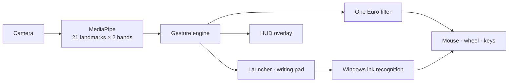

<div align="center">

# ZEHEN

**The computer, operated by hand.**

Laptop camera &nbsp;·&nbsp; No extra hardware &nbsp;·&nbsp; Fully offline

<br>

<a href="https://priyanshusta.github.io/ZEHEN/#demo"></a>

<sub>Recorded with <b>WinScreen Studio</b> &nbsp;·&nbsp; <a href="https://priyanshusta.github.io/ZEHEN/#demo">Watch the full video →</a></sub>

<br><br>

[Website](https://priyanshusta.github.io/ZEHEN/) &nbsp;&nbsp;·&nbsp;&nbsp; [Install](#install) &nbsp;&nbsp;·&nbsp;&nbsp; [Gestures](#gestures) &nbsp;&nbsp;·&nbsp;&nbsp; [Roadmap](ROADMAP.md) &nbsp;&nbsp;·&nbsp;&nbsp; [Contributing](CONTRIBUTING.md)

</div>

<br>

## Overview

ZEHEN turns an ordinary webcam into a precision input device. It tracks 21 points on each hand, reads
gestures in real time, and drives Windows directly: cursor, clicks, scrolling, zoom, app switching,
an app launcher, and handwriting typed from the air.

There is nothing to wear and nothing to install beyond Python. The camera is never shown, and no frame
ever leaves the machine.

## Install

Windows 10 or 11, Python 3.10+.

```bash
git clone https://github.com/priyanshusta/ZEHEN.git
cd ZEHEN
.\ZEHEN.bat
```

`ZEHEN.bat` locates Python, installs dependencies on first run, and starts ZEHEN in the background.
A short guided tutorial runs the first time.

## Gestures

| Gesture | Action |
|---|---|
| Index finger up | Move cursor |
| Pinch, thumb and index | Click. Hold to drag |
| Pinch twice | Open |
| Index up, thumb to middle | Right-click |
| Two fingers up | Scroll |
| Open palm, hold | Launcher |
| Three fingers, hold | Writing pad |
| Both hands pinch, stretch | Zoom |
| Other hand swipes | Switch app |
| Fist | Pause |

The right hand drives the cursor; the left issues commands. Either hand works alone. Touching the real
mouse hands control back instantly.

## Capabilities

**Launcher.** Open windows, favourite apps, search across every installed app, and system controls,
all one pinch away.

**Writing pad.** Write in the air. Windows' on-device handwriting recognition converts the ink and
types it into the active app, with alternatives for every word.

**Precision.** One Euro filtering, debounced gestures, scale-invariant pinch detection, and click
locking make hand input as accurate as a touchpad.

**Awareness.** A transparent HUD shows the cursor, the active gesture, and a live wireframe of your
hands. It never takes focus away from the app you are using.

## Architecture



One file, [`zehen.py`](zehen.py). Tracking runs on a background thread and publishes a snapshot each
frame; the HUD only renders it. Every value that affects feel is a documented constant at the top.

## Configuration

`%USERPROFILE%\.zehen.json`

| Key | Default | Purpose |
|---|---|---|
| `main_hand` | `"Right"` | Hand that drives the cursor |
| `apps` | built-in list | Launcher favourites, by Start menu name |
| `camera` | auto | Camera index; ZEHEN skips virtual cameras and finds a live one |
| `tutorial_done` | `false` | Set to `false` to see the tutorial again |

## Privacy

Frames are processed in memory and discarded. Hand tracking and handwriting recognition run on-device.
No accounts, no telemetry, no network calls beyond a one-time model download. Details in
[SECURITY.md](SECURITY.md).

## Roadmap

| | Release | Focus |
|---|---|---|
| ● | **Mark I** | Cursor, gestures, two-hand zoom, launcher, air-writing. *Shipped.* |
| ○ | **Mark II** | Calibration, custom gestures, multi-monitor, installer |
| ○ | **J.A.R.V.I.S.** | Offline voice. Point at a window and speak |
| ○ | **Holo-table** | Throw windows between screens, manipulate 3D objects |
| ○ | **Stark** | AR glasses, gaze plus hand, plugin API |

Full plan: [ROADMAP.md](ROADMAP.md).

## Verify

```bash
python zehen.py --test
```

Covers gesture classification, filtering, app search, every panel layout, handwriting recognition and
model loading. To re-record the demo: `python demo/record_demo.py`.

## Contributing

Issues and pull requests are welcome. Read [CONTRIBUTING.md](CONTRIBUTING.md) and the
[Code of Conduct](CODE_OF_CONDUCT.md) first. Release notes live in [CHANGELOG.md](CHANGELOG.md).

## Credits

Created by [@priyanshusta](https://github.com/priyanshusta). Developed with Claude by Anthropic.
Demo recorded with **WinScreen Studio**.
Built on [MediaPipe](https://ai.google.dev/edge/mediapipe), [OpenCV](https://opencv.org),
[PyAutoGUI](https://pyautogui.readthedocs.io) and Windows Ink.

## License

[MIT](LICENSE)
