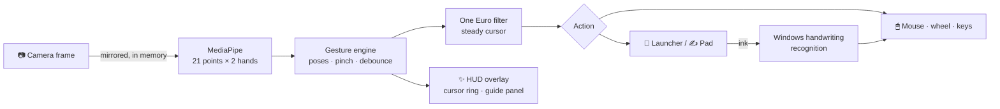

<div align="center">

# ◉ ZEHEN

### Your hand is the mouse.

Control Windows with hand gestures through your laptop camera.<br>
Point, pinch, scroll, zoom, launch apps and **write in the air**. No gloves, no extra hardware, nothing leaves your PC.

[](LICENSE)
[](#-quick-start)
[](requirements.txt)
[](SECURITY.md)

<br>


<sub>Recorded on a live Windows desktop with the real ZEHEN app: real launcher, real handwriting recognition, real typing, scrolling and zoom. Only the hand motion is scripted for the recording. <a href="docs/media/zehen-demo.mp4">Full-quality video ▸</a></sub>

<br><br>

**[Quick start](#-quick-start)** · **[Gestures](#-gestures)** · **[How it works](#-how-it-works)** · **[Roadmap](ROADMAP.md)** · **[Website](docs/index.html)** · **[Contributing](CONTRIBUTING.md)**

</div>

---

## ✨ Why ZEHEN

In the movies, people move holograms with their hands. ZEHEN brings the first real piece of that to the
laptop you already own. Raise your hand and a glowing cursor ring appears; pinch to click, hold an open
palm to summon a launcher, write a word in the air and watch it get typed.

| | |
|---|---|
| 🎥 **Invisible camera** | Tracking runs in the background. A see-through HUD shows a glowing cursor ring and what you're doing. |
| ✍️ **Air-writing** | Pinch and write in the air. Windows' offline handwriting recognition types it into any app, with "did you mean" fixes. |
| 🚀 **Launcher** | Hold an open palm: your open windows, favourite apps, a search across every installed app, and system controls. |
| 🙌 **Two hands** | Stretch both hands to zoom like a photo. Swipe your other hand to flick between apps. |
| 🎯 **Steady and precise** | One Euro smoothing, debounced gestures and click-lock make a hand feel as accurate as a touchpad. |
| 🧭 **Learns with you** | A guided tutorial on first run, a live wireframe of your hands, and a gesture guide that lights up as you move. |
| 🔒 **Private by design** | Video is analysed in memory and dropped. Hand tracking and handwriting both run offline. |

## 🚀 Quick start

Needs **Windows 10/11** and **Python 3.10+** ([python.org](https://www.python.org/downloads/)).

```bash
git clone https://github.com/priyanshusta/ZEHEN.git
cd ZEHEN
.\ZEHEN.bat
```

`ZEHEN.bat` finds Python even if it isn't on your PATH, installs the libraries on first run, and starts
ZEHEN without a console window. The first time, ZEHEN asks for camera permission and walks you through
every gesture. Replay the tutorial any time with **tutorial ↻** on the panel.

<details>
<summary>Prefer the terminal?</summary>

```bash
python -m pip install -r requirements.txt
python zehen.py
```
</details>

## 🖐 Gestures

| Gesture | What it does |
|---|---|
| ☝️ **Index finger up** | Move the cursor |
| 🤏 **Pinch** thumb + index | Click. Hold and move to drag |
| 🤏🤏 **Pinch twice quickly** | Open: a double-click on apps, files and folders |
| 👌 **Index up, thumb to middle finger** | Right-click |
| ✌️ **Two fingers up** | Scroll: raise your hand to go up, lower it to go down |
| 🖐️ **Open palm, hold** | Launcher. Hold again to close any panel |
| ✍️ **Three fingers up, hold** | Writing pad |
| 🙌 **Both hands pinch, then stretch** | Zoom in / out |
| 👋 **Swipe your other hand** | Switch to your last app |
| ✊ **Fist** | Pause |

Your right hand drives the cursor and your left hand gives commands. With one hand up, either hand
works. Touch the real mouse or touchpad and ZEHEN lets go of the cursor for a moment.

### 🚀 Launcher

Hold an open palm, point at a tile and pinch to tap it.

- **Open windows**: jump straight to any window
- **Apps**: your favourites, plus **Search all apps**: write an app's name in the air, then tap the match
- **Controls**: keyboard, writing pad, files, desktop, task view, screenshot, maximize, minimize,
  close window, volume, play / pause

### ✍️ Writing pad

Pinch and write in the box; pause for a second and the ink turns into typed text in the app you were
using. Buttons: **⌫** letter, **⌫ word**, **space**, **enter**, **clear ink**, **close**. If a word
comes out wrong, tap one of the "did you mean" chips.

## 🧠 How it works



- **See**: each camera frame is mirrored and handed to MediaPipe, never stored or shown.
- **Track**: 21 landmarks per hand, both hands, every frame, on-device.
- **Understand**: finger poses and pinch distance (scaled to your hand size, so near or far both work),
  held for a few frames before they count.
- **Act**: real mouse, wheel and keystrokes, plus the HUD so you always see what happened.

## ⚙️ Settings

Everything that changes how ZEHEN *feels* (smoothing, pinch sensitivity, hold time, scroll speed,
double-pinch timing) is a commented knob at the top of [`zehen.py`](zehen.py).

Personal settings live in `%USERPROFILE%\.zehen.json`:

| Key | Example | Meaning |
|---|---|---|
| `main_hand` | `"Left"` | Which hand drives the cursor (default `"Right"`) |
| `apps` | `["Spotify", "Notepad"]` | Favourite apps in the launcher, by Start menu name |
| `camera` | `1` | Camera ZEHEN found last time (it searches again if this one stops working) |
| `tutorial_done` | `false` | Show the tutorial again on next start |

## 🛠 Troubleshooting

| Problem | Fix |
|---|---|
| "Can't reach the camera" | Close other apps using it. Turn on Windows Settings › Privacy & security › Camera › *Let desktop apps access your camera*. Check for a lens shutter or camera F-key. |
| A black / frozen camera | Virtual cameras (PRISM Lens, OBS) are skipped automatically; ZEHEN picks the first camera with a live picture. |
| Cursor shaky or laggy | Lower `MIN_CUTOFF` for steadier, raise `BETA` for snappier. |
| Clicks fire too easily | Lower `PINCH_ON`. Not easily enough? Raise it. |
| `python` not recognized | Use `ZEHEN.bat`, it finds Python for you. |

Run the self-test any time: `python zehen.py --test`. It checks gesture detection, smoothing, app
search, every panel's layout, real handwriting recognition and the hand model.

## 🛰 Roadmap

| Version | Theme | Highlights |
|---|---|---|
| ✅ **Mark I** | Your hand is the mouse | Cursor, clicks, scroll, two-hand zoom, launcher, air-writing, tutorial |
| 🔭 **Mark II** | Feel it | Calibration wizard, custom gestures, sound feedback, multi-monitor, installer |
| 🔭 **J.A.R.V.I.S.** | Talk to it | Wake word, offline voice, "point at a window and say maximize" |
| 🧪 **Holo-table** | Grab the interface | Throw windows between screens, rotate 3D models, push to press |
| 🧪 **Stark** | Beyond the screen | AR glasses, eye + hand targeting, smart home, plugin API |

The full plan, with every idea, is in **[ROADMAP.md](ROADMAP.md)**. Seen a gesture in a movie you want?
[Suggest it](../../issues/new?template=feature_request.md).

## 📁 Project layout

| Path | What |
|---|---|
| [`ZEHEN.bat`](ZEHEN.bat) | Double-click launcher |
| [`zehen.py`](zehen.py) | The whole app: tracking, gestures, HUD, launcher, writing pad, self-test |
| [`hand_landmarker.task`](hand_landmarker.task) | MediaPipe hand model (re-downloaded automatically if missing) |
| [`demo/`](demo) | Records the demo video on your desktop: `python demo/record_demo.py` |
| [`docs/`](docs) | Project website and demo media |
| [`build.bat`](build.bat) | Optional: builds a standalone `dist\ZEHEN.exe` |

## 🤝 Contributing

Ideas, bug reports and pull requests are all welcome. Start with **[CONTRIBUTING.md](CONTRIBUTING.md)**,
and please follow the **[Code of Conduct](CODE_OF_CONDUCT.md)**. Found a privacy or security issue? See
**[SECURITY.md](SECURITY.md)**. Changes are tracked in **[CHANGELOG.md](CHANGELOG.md)**.

## 🏆 Credits

| | |
|---|---|
|  | **Priyanshu Makwana** ([@priyanshusta](https://github.com/priyanshusta))<br>Creator and maintainer. Idea, direction and every "make it perfect". |
| 🤖 | **Claude** by [Anthropic](https://www.anthropic.com)<br>AI pair programmer: co-wrote the code, docs and demo. |

Built on the shoulders of [MediaPipe](https://ai.google.dev/edge/mediapipe) (hand tracking),
[OpenCV](https://opencv.org) (camera), [PyAutoGUI](https://pyautogui.readthedocs.io) (mouse and keyboard)
and Windows Ink (handwriting recognition).

## 📜 License

[MIT](LICENSE) © 2026 Priyanshu Makwana. Use it, fork it, build the future with it.

<div align="center"><br><sub>◉ If ZEHEN made you feel a little like a superhero, give it a ⭐</sub></div>
