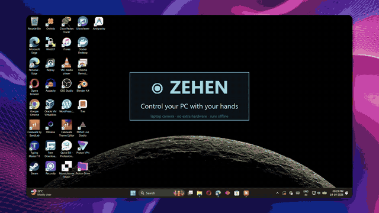
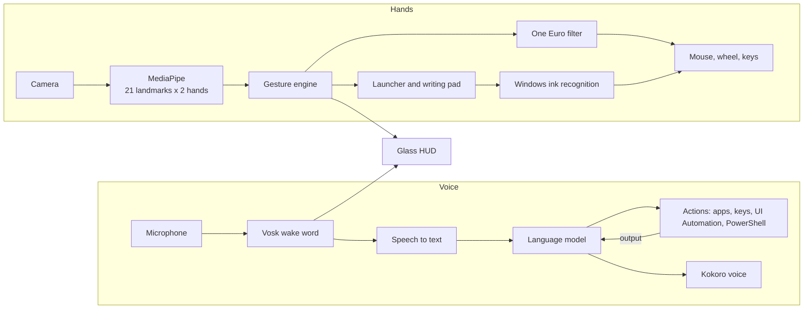

<div align="center">



<br>

**Hand-gesture and voice control for Windows. Free, open source, runs on the laptop you already own.**

<a href="LICENSE"></a>


[Website](https://priyanshusta.github.io/ZEHEN/) &nbsp;|&nbsp; [Install](#install) &nbsp;|&nbsp; [Gestures](#gestures) &nbsp;|&nbsp; [Voice](#voice-noor) &nbsp;|&nbsp; [How it works](#how-it-works) &nbsp;|&nbsp; [Privacy](#privacy-and-safety) &nbsp;|&nbsp; [FAQ](#faq) &nbsp;|&nbsp; [Roadmap](ROADMAP.md)

<br>

<a href="https://priyanshusta.github.io/ZEHEN/#demo"></a>

<sub>Recorded with WinScreen Studio. <a href="https://priyanshusta.github.io/ZEHEN/#demo">Watch the full video</a>.</sub>

</div>

<br>

## Overview

ZEHEN turns an ordinary webcam into a precision input device and an ordinary microphone into a command line
for your whole PC. It tracks 21 points on each hand, reads gestures in real time and drives Windows directly:
cursor, clicks, scrolling, zoom, app switching, a launcher and handwriting typed from the air.

Say **"Zehen"** and an assistant named **Noor** takes over: she opens apps, clicks and types inside them,
runs PowerShell, searches the web, talks with you and answers out loud in a natural female voice. Everyday
commands ("scroll down", "click", "open YouTube") run instantly with no AI at all. Your hands keep working
while she does, and one button turns the camera off for voice-only use.

<table>
<tr>
<td width="33%" valign="top">

**Hands**

Point to move, pinch to click, two fingers to scroll, both hands to zoom, swipe to switch apps, three fingers
to write in the air. Smoothed and debounced to feel like a touchpad.

</td>
<td width="33%" valign="top">

**Voice**

One wake word, then plain language. Noor plans the steps, does them, reads the result and keeps going until
the job is done. Offline wake word, offline voice, offline brain if you want one.

</td>
<td width="33%" valign="top">

**Glass interface**

A small translucent pill shows what your hand or voice is doing. Point at it and it opens into the full
panel, then folds back on its own.

</td>
</tr>
</table>

## Install

Windows 10 or 11, Python 3.10 or newer, a webcam and a microphone.

```bash
git clone https://github.com/priyanshusta/ZEHEN.git
cd ZEHEN
.\ZEHEN.bat
```

`ZEHEN.bat` finds Python, installs the dependencies on first run and starts ZEHEN in the background. The
first time, Noor introduces herself, sets up her own brain (a one-time download, shown with a progress bar) and
walks you through every gesture out loud, step by step, then learns your wake word. To quit, use the close button on the panel.

First run downloads a few models once into `%USERPROFILE%\.zehen`:

| Model | Size | Used for | License |
|---|---|---|---|
| MediaPipe Hand Landmarker | 8 MB | Hand tracking | Apache-2.0 |
| Vosk small English | 40 MB | Wake word and a backup ear | Apache-2.0 |
| Whisper base.en (faster-whisper) | 145 MB | Understanding what you say, on the PC | MIT |
| Kokoro 82M (int8) | 120 MB | Noor's voice | Apache-2.0 |
| Qwen3 1.7B (optional) | 1.1 GB | Offline brain when you have no key | Apache-2.0 |

## Gestures

| Gesture | Action |
|---|---|
| Index finger up | Move the cursor |
| Pinch, thumb and index | Click. Hold to drag |
| Pinch twice | Open |
| Index up, thumb to middle finger | Right-click |
| Two fingers up | Scroll |
| Open palm, hold | Launcher |
| Three fingers, hold | Writing pad |
| Both hands pinch, then stretch | Zoom |
| Other hand swipes | Switch app |
| Fist | Pause |

The right hand drives the cursor and the left issues commands. Either hand works alone. Touching the real
mouse or touchpad hands control back instantly. Pointing at the pill for a moment opens the full panel.

## Voice: Noor

Her name is Noor. She greets you when ZEHEN starts, then listens for one word.

```text
"Zehen, open Spotify."
"Zehen, search for flights to Goa on Edge."
"Zehen, what is using my CPU?"
"Zehen, move everything in Downloads older than a month to D drive."
"Zehen, open Notepad and write a shopping list."
```

**How a request runs**

1. **Wake.** Her ear is on your PC. During the tutorial she learns how *you* say "Zehen" (three samples), so
   she wakes for your voice and accent and nothing else. The word only counts at the start of a phrase, so
   ordinary talk ("that is insane") never wakes her. Until she has learned it, a speech model's best guess is used.
2. **Hear.** Your request is transcribed by Whisper running on the PC (about 0.4 s, any accent, and it is told your
   app and window names so "Jupyter" stays Jupyter). With a Groq key, Groq's larger Whisper is used instead. A second
   transcript from the wake-word model is kept as a backup, so "click" heard as "like" is still understood, and a
   single stray word is treated as noise rather than a request.
3. **Plan.** A language model returns a few actions as strict JSON. Anything outside the known action list is
   dropped.
4. **Act.** Open apps, focus windows, open links, search the web, type in any language, press shortcuts,
   control windows and volume, click buttons and list items by name in any app, and run PowerShell.
5. **Look.** The output of PowerShell and the names of what is clickable are fed back, and she continues
   until the job is done (six steps at most).
6. **Answer.** She says what she did in a natural voice, so you never need to look at the screen. Ask her a
   question and she answers like a person, remembers the last few things you said, and keeps listening for your
   reply without needing the wake word again.

**Instant commands, no AI.** "Scroll down", "scroll up a lot", "click", "double click", "right click",
"go back", "new tab", "copy", "paste", "zoom in", "volume down", "pause", "close window", "type hello",
"search for flights", "open YouTube" and chains like "open YouTube and click on trending" are understood on the
PC in milliseconds. Point with your finger, say "click", and it clicks where you point.

Say **"turn off the camera"** (or press the CAM button on the panel) for voice-only mode: the camera really
stops, its light goes out. Say **"learn my voice"** to teach her your wake word again.

Clicking inside apps uses Windows UI Automation: it reads the accessible names of buttons, tabs, text boxes and
list items as text. No screenshots and no vision model are involved, so it costs almost no memory. It cannot see
pictures or unlabeled icons, and apps that expose no accessibility information can only be driven with keys.

**Choose her brain. Both are free.**

| | Free cloud key | Offline brain |
|---|---|---|
| Setup | Panel, Get key, sign in, Paste key | None. Downloads once (1.1 GB) |
| Model | Groq `gpt-oss-120b`, Gemini Flash or OpenRouter free | Qwen3 1.7B on your CPU |
| Speed and skill | Fast and strong. Handles multi-step plans | Slower and simpler |
| Cost | Free plan with rate limits that providers can change | Free forever |
| Leaves your PC | What you say after the wake word, plus app and window names | Nothing |

`AIza...` (Gemini) and `sk-or-...` (OpenRouter) keys are recognised automatically. Any OpenAI-compatible
service works through the `llm` setting.

> **There is no confirmation step.** PowerShell runs as you, so a wrong or manipulated answer can delete files or
> send things. Pausing (fist, or the pause button) stops Noor between steps, and `"voice": false` turns the
> microphone off entirely.

## How it works



One file, [`zehen.py`](zehen.py). Tracking runs on a background thread and publishes a snapshot each frame;
the HUD only renders it. Voice runs on its own thread. Every value that affects feel is a documented constant
at the top.

## Configuration

`%USERPROFILE%\.zehen.json`

| Key | Default | Purpose |
|---|---|---|
| `main_hand` | `"Right"` | Hand that drives the cursor |
| `apps` | built-in list | Launcher favourites, by Start menu name |
| `camera` | auto | Camera index. ZEHEN skips virtual cameras and finds a live one |
| `tutorial_done` | `false` | Set to `false` to see the tutorial again |
| `voice` | `true` | Set to `false` to turn off the microphone and voice control |
| `camera_on` | `true` | `false` is voice-only mode (set by the CAM button or "turn off the camera") |
| `tutorial_voice` | `true` | Set to `false` to stop Noor narrating the tutorial |
| `brain_setup` | `true` | Set to `false` to skip downloading the offline brain on first run |
| `no_follow_up` | `false` | Set to `true` so she doesn't keep listening after an answer |
| `greeting` | `true` | Set to `false` to skip Noor's hello at start-up |
| `wake` | `["zane"]` | Only used before she has learned your voice: spellings the speech model may write for "Zehen" |
| `stt_model` | `"base.en"` | Hearing model: `tiny.en` is quicker, `small.en` (480 MB) is sharper |
| `voice_name` | `"af_heart"` | Kokoro voice. Other female voices: `af_bella`, `af_nicole`, `af_sarah`, `af_sky`, `bf_emma` |
| `llm` | none | `api_key` (set by Paste key, or env `ZEHEN_API_KEY`), optional `base_url` and `model` for any OpenAI-compatible service |

## Privacy and safety

- **Camera.** Frames are processed in memory and discarded. Nothing is shown, recorded, saved or uploaded.
- **Microphone.** The wake word runs on your PC. Audio is only used after you say it, and it is only sent
  anywhere if you added a Groq key (for Whisper).
- **Requests.** With a cloud key, your request, your app and window names and command output go to the provider
  that issued the key. Free plans can use data to improve their products, so read the provider's terms. With the
  offline brain, nothing leaves the PC.
- **Key.** Stored in plain text in `.zehen.json`.
- **No accounts, no telemetry, no ads.**

Details and how to report a problem are in [SECURITY.md](SECURITY.md).

## Requirements and performance

| | |
|---|---|
| OS | Windows 10 or 11 |
| Memory | About 0.7 GB with the camera, hand tracking, voice recognition and Noor's voice loaded |
| Disk | About 0.3 GB, plus 1.1 GB if you use the offline brain |
| CPU | Any modern laptop. Hand tracking runs at camera speed on CPU |
| Network | Only for first-run downloads and, optionally, a free cloud key |

## FAQ

<details>
<summary><b>Is ZEHEN really free?</b></summary>
<br>
Yes. It is MIT licensed, has no paid tier and needs no account. The optional cloud brain uses providers' free
plans; if one changes, switch keys or use the offline brain.
</details>

<details>
<summary><b>Can I control my computer with hand gestures using only a webcam?</b></summary>
<br>
Yes. ZEHEN uses MediaPipe to track both hands from a normal laptop camera and drives the real Windows cursor,
clicks, scrolling and zoom. No gloves, depth camera or other hardware.
</details>

<details>
<summary><b>Is it a free, open source Jarvis for Windows?</b></summary>
<br>
That is the idea. Say the wake word, ask in plain language, and an AI assistant operates your PC and answers
out loud. The wake word, speech engine and voice are open source and run offline.
</details>

<details>
<summary><b>Does it work offline?</b></summary>
<br>
Hand tracking, handwriting, the wake word and Noor's voice are offline. Planning needs a brain: the offline
Qwen3 model works with no internet after its one-time download.
</details>

<details>
<summary><b>It does not wake when I say "Zehen".</b></summary>
<br>
The speech model has no word "zehen" and hears it as "zane". If your accent differs, add spellings to `wake`
in <code>.zehen.json</code>. Say the word at the start of a phrase, then continue.
</details>

<details>
<summary><b>Does it work on macOS or Linux?</b></summary>
<br>
Not yet. Windows specific parts are the window and app control, handwriting recognition and UI Automation.
See the <a href="ROADMAP.md">roadmap</a>.
</details>

## Roadmap, contributing, license

- [ROADMAP.md](ROADMAP.md): where ZEHEN is going.
- [CONTRIBUTING.md](CONTRIBUTING.md): how to run it, how the code is laid out, how to send a pull request.
- [CHANGELOG.md](CHANGELOG.md): what changed.
- [MIT License](LICENSE).

## Acknowledgements

[MediaPipe](https://github.com/google-ai-edge/mediapipe) for hand tracking, [Vosk](https://alphacephei.com/vosk/)
for offline speech recognition, [Kokoro](https://github.com/hexgrad/kokoro) and
[kokoro-onnx](https://github.com/thewh1teagle/kokoro-onnx) for the voice, [Qwen3](https://github.com/QwenLM/Qwen3)
and [llama.cpp](https://github.com/ggml-org/llama.cpp) for the offline brain,
[uiautomation](https://github.com/yinkaisheng/Python-UIAutomation-for-Windows) for clicking inside apps, and the
One Euro filter by Casiez, Roussel and Vogel.

<div align="center">
<sub>Created by <a href="https://github.com/priyanshusta">@priyanshusta</a>. Developed with Claude.</sub>
</div>
